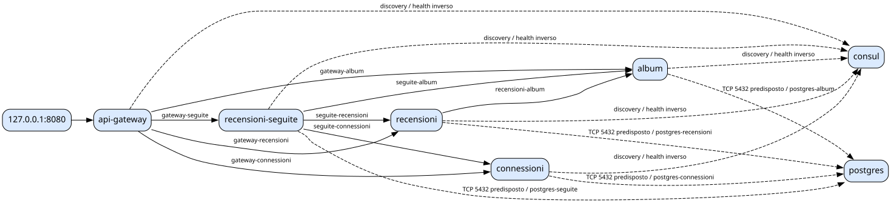

# BetterMusic con Docker

Ho dockerizzato BetterMusic per poter costruire e avviare tutti i servizi con
un unico comando, senza dover configurare Java e Gradle su ogni computer.
L'applicazione mantiene la struttura a microservizi: ogni servizio Java ha il
proprio container, Consul si occupa della discovery e PostgreSQL è predisposto
per la futura gestione dei dati.

In questa guida raccolgo i passaggi per avviare il progetto e le motivazioni delle
scelte fatte nella configurazione Docker. La descrizione del dominio e delle API
rimane nel [README originale](README.md).

## Cosa viene avviato

Il [docker-compose.yml](docker-compose.yml) principale avvia sette container.

| Servizio | Cosa fa | Porta interna | Accesso dal computer |
|---|---|---|---|
| `api-gateway` | Riceve le richieste HTTP e le inoltra al servizio corretto | 8080 | `http://127.0.0.1:8080` |
| `album` | Gestisce gli album e le ricerche per artista e genere | 8080 | Attraverso il Gateway |
| `recensioni` | Gestisce le recensioni e consulta Album tramite REST | 8080 | Attraverso il Gateway |
| `connessioni` | Gestisce artisti, generi e recensori seguiti dagli utenti | 8080 | Attraverso il Gateway |
| `recensioni-seguite` | Aggrega le informazioni degli altri tre backend | 8080 | Attraverso il Gateway |
| `consul` | Mantiene il catalogo dei servizi e ne controlla lo stato | 8500 | Nessuna porta pubblicata |
| `postgres` | Mette a disposizione PostgreSQL per la futura persistenza | 5432 | Nessuna porta pubblicata |

L'intero progetto presente nel repository è un backend REST. Non è prevista
un'interfaccia grafica con una homepage: per usarlo si chiamano le API esposte
dal Gateway. I moduli `*-api` sono librerie condivise tra i servizi e vengono
compilati insieme a questi, quindi non richiedono container separati.
Kafka ha configurazioni proprie nella cartella [kafka](kafka/) e non fa parte
dello stack principale, perché i servizi attuali comunicano tramite REST.

**PostgreSQL è pronto come infrastruttura, ma i datasource Java usano ancora
HSQLDB in memoria.** Non sono stati aggiunti schemi, tabelle, migrazioni o
collegamenti JDBC verso PostgreSQL.

## Cosa serve prima di partire

Servono Docker installato e avviato, Docker Compose con supporto alle opzioni
`--wait` e `--wait-timeout`, e una connessione Internet per scaricare immagini e
dipendenze durante la prima build. I limiti di memoria dei sette container sommano
4,5 GiB; la compilazione richiede memoria aggiuntiva. Non serve installare Java
o Gradle sul computer.

Su Linux si possono usare [Docker Engine](https://docs.docker.com/engine/install/)
e il [plugin Compose](https://docs.docker.com/compose/install/linux/).
Su macOS e Windows, [Docker Desktop](https://docs.docker.com/compose/install/)
include i componenti necessari. Su Windows deve essere selezionata la modalità
Linux containers, perché tutte le immagini del progetto sono Linux.

I comandi di questa guida vanno eseguiti dalla cartella del repository.

## Avvio con gli script

Ho aggiunto due script per evitare di ripetere a mano i passaggi di configurazione,
download, build e avvio. Gli script controllano che Docker sia raggiungibile,
chiedono la password PostgreSQL se manca, scaricano Consul e PostgreSQL,
costruiscono le cinque immagini Java e attendono che i container siano pronti.
Docker Engine o Docker Desktop devono essere già installati e avviati.

### Linux

```bash
bash ./start-docker.sh
```

Il comando funziona anche se il terminale usa Fish, perché lo script viene
eseguito esplicitamente con Bash. Non serve renderlo eseguibile con `chmod`.
Su un sistema con systemd, se Docker non è avviato:

```bash
sudo systemctl start docker
docker info
```

Dopo che `docker info` mostra anche la sezione Server, si può lanciare lo script.
La password richiesta da `sudo` è quella dell'utente Linux.

### macOS

Avviare Docker Desktop e attendere che il motore sia pronto. Poi, dal Terminale:

```bash
bash ./start-docker.sh
```

Il comando è lo stesso anche quando la shell predefinita è Zsh.

### Windows

Avviare Docker Desktop con container Linux e aprire PowerShell nella cartella
del progetto:

```powershell
powershell.exe -NoProfile -ExecutionPolicy Bypass -File .\start-docker.ps1
```

Con PowerShell 7 si può usare:

```powershell
pwsh -NoProfile -ExecutionPolicy Bypass -File .\start-docker.ps1
```

`-ExecutionPolicy Bypass` vale per il processo avviato e non cambia la policy
permanente del computer. Le eventuali policy aziendali hanno comunque la
precedenza; il comportamento è descritto nella
[documentazione PowerShell](https://learn.microsoft.com/en-us/powershell/module/microsoft.powershell.core/about/about_execution_policies).

### Cosa aspettarsi durante l'avvio

Se `POSTGRES_PASSWORD` non è già presente nell'ambiente, lo script chiede di
inserirla due volte senza mostrarla. La password non viene scritta in file o
aggiunta al repository. Se esiste già un volume PostgreSQL, bisogna usare la
password scelta quando quel volume è stato inizializzato.

Il primo avvio può richiedere diversi minuti per scaricare le immagini e compilare
le applicazioni. Lo script attende gli healthcheck fino a 300 secondi dopo
l'avvio dei container. In caso di errore in questa fase mostra lo stato dei
servizi e gli ultimi log; quando termina correttamente stampa l'indirizzo
`http://127.0.0.1:8080`.

La password inserita nello script viene passata ai suoi comandi Docker, ma non
rimane impostata nel terminale chiamante. Per eseguire successivamente comandi
Compose a mano bisogna impostare la variabile anche in quel terminale, come
spiegato nella sezione seguente.

Gli script avviano tutto lo stack senza caricare dati dimostrativi. Possono essere
rilanciati: la build riutilizza la cache Docker e il volume PostgreSQL viene
conservato. Individuano il Compose rispetto alla propria posizione, quindi si
possono eseguire anche da un'altra cartella indicando il percorso dello script.

## Password e avvio manuale

Ho lasciato la password fuori dal Compose per permettere a ciascuno di scegliere
la propria. La variabile `POSTGRES_PASSWORD` è obbligatoria: se è assente o vuota,
Compose si ferma prima di costruire o avviare i servizi.

Per impostarla senza inserirla nella cronologia, scegliere il blocco adatto alla
shell in uso. La password deve essere non vuota.

### Bash, su Linux o macOS

```bash
read -rsp 'Password PostgreSQL: ' POSTGRES_PASSWORD
echo
export POSTGRES_PASSWORD
```

### Fish

```fish
read --global --export --silent --prompt-str 'Password PostgreSQL: ' POSTGRES_PASSWORD
```

La sintassi `read -rsp` appartiene a Bash e non funziona in Fish. La variabile
impostata con questo comando è esportata ai processi lanciati dalla stessa
sessione del terminale.

### PowerShell

```powershell
$password = Read-Host 'Password PostgreSQL' -AsSecureString
$passwordPointer = [Runtime.InteropServices.Marshal]::SecureStringToBSTR($password)
try {
    $env:POSTGRES_PASSWORD = [Runtime.InteropServices.Marshal]::PtrToStringBSTR($passwordPointer)
} finally {
    [Runtime.InteropServices.Marshal]::ZeroFreeBSTR($passwordPointer)
    $password.Dispose()
}
```

Dopo aver impostato la password, questi comandi sono uguali sui tre sistemi:

```text
docker compose config --quiet
docker compose up -d --build --wait --wait-timeout 300
docker compose ps
```

La password vale per l'installazione locale e non viene condivisa con chi scarica
il repository. PostgreSQL la usa solo alla prima inizializzazione di un volume
vuoto: cambiare la variabile in seguito non modifica la password salvata nel
database. In una nuova sessione del terminale va impostata nuovamente.

## Come provare l'applicazione

Dopo l'avvio, controllare che il Gateway risponda:

```bash
curl --fail http://127.0.0.1:8080/actuator/health
```

Il risultato atteso contiene `"status":"UP"`. Su Windows PowerShell usare
`curl.exe --fail` al posto di `curl --fail`, perché `curl` può essere un alias
di un comando PowerShell.

Per caricare i dati di esempio su un'applicazione appena avviata:

```bash
bash do-init-bettermusic-db.sh
bash run-sample-queries.sh
```

Questi script richiedono Bash, curl e jq. Su Windows vanno eseguiti in un ambiente
Bash, per esempio Git Bash. Inseriscono dati tramite le API dei servizi e non
creano tabelle su PostgreSQL. L'inizializzazione va eseguita una sola volta su
dati vuoti; i conteggi iniziali delle recensioni seguite da Alice, Bob e Carlo
sono rispettivamente 5, 6 e 5.

Le API si possono raggiungere anche dal browser:

| Dati | Indirizzo |
|---|---|
| Album | `http://127.0.0.1:8080/album/album` |
| Recensioni | `http://127.0.0.1:8080/recensioni/recensioni` |
| Connessioni | `http://127.0.0.1:8080/connessioni/connessioni` |
| Recensioni seguite da Alice | `http://127.0.0.1:8080/recensioni-seguite/recensioniseguite/Alice` |

Il percorso `/album/album` è voluto: il primo segmento identifica la rotta del
Gateway e viene rimosso prima di inoltrare la richiesta; il secondo appartiene
al controller del servizio Album. Il funzionamento delle altre rotte segue
la stessa logica.

## Perché un Dockerfile condiviso

I cinque servizi Java hanno lo stesso modo di compilazione e di esecuzione.
Ho quindi scelto un [Dockerfile](Dockerfile) comune, parametrizzato con l'argomento
`SERVICE`, per evitare cinque file quasi identici da mantenere. Ogni servizio
ha comunque la propria immagine e il proprio container.

La build è divisa in due fasi. La prima usa `gradle:8.14.3-jdk21-alpine` e compila
il `bootJar` del servizio richiesto, insieme alle librerie `*-api` necessarie.
Il progetto non contiene il Gradle Wrapper: viene usato il Gradle dell'immagine.
La seconda fase usa `eclipse-temurin:21.0.9_10-jre-alpine-3.22` e riceve soltanto
il JAR, avviato con `java -jar /app/app.jar`. In questo modo il container che
esegue l'applicazione non deve contenere Gradle e tutti gli strumenti di build.

Consul usa `hashicorp/consul:1.22.0`, mentre PostgreSQL usa `postgres:18-alpine`.
I tag scelgono una versione esplicita; il tag PostgreSQL segue gli aggiornamenti
della versione principale 18. I tag non sono digest immutabili, quindi gli
aggiornamenti delle immagini vanno verificati prima di adottarli.

Il contesto di build è la root del repository. Il file [.dockerignore](.dockerignore)
esclude cache, build locali, Git, documentazione, Kafka e file sensibili come
`.env` e chiavi, così non vengono inviati inutilmente al builder.

Per cambiare le immagini di compilazione e runtime senza modificare il Dockerfile:

```bash
docker compose build --build-arg GRADLE_IMAGE=gradle:8.14.3-jdk21-alpine --build-arg JRE_IMAGE=eclipse-temurin:21.0.9_10-jre-alpine-3.22
```

## Perché le reti sono separate

Ho mantenuto le reti allineate alle comunicazioni previste tra i servizi.
Il Gateway deve raggiungere i quattro backend, Recensioni deve consultare Album
e l'aggregatore deve interrogare Album, Recensioni e Connessioni. Ogni applicazione
deve inoltre raggiungere Consul. Per PostgreSQL ho predisposto un collegamento
distinto con ciascun backend.

La configurazione contiene **18 reti bridge: una `public` e 17 con
`internal: true`**. Ogni rete interna ha due soli membri; non viene creata una
rete `default` comune a tutti i container.



| Rete | Container collegati | `internal` | Motivo |
|---|---|---|---|
| `public` | api-gateway | false | Accesso HTTP dall'host e connettività esterna del Gateway |
| `gateway-album` | api-gateway, album | true | Richieste verso Album |
| `gateway-recensioni` | api-gateway, recensioni | true | Richieste verso Recensioni |
| `gateway-connessioni` | api-gateway, connessioni | true | Richieste verso Connessioni |
| `gateway-seguite` | api-gateway, recensioni-seguite | true | Richieste verso l'aggregatore |
| `recensioni-album` | recensioni, album | true | Consultazione degli album da Recensioni |
| `seguite-album` | recensioni-seguite, album | true | Aggregazione degli album |
| `seguite-recensioni` | recensioni-seguite, recensioni | true | Aggregazione delle recensioni |
| `seguite-connessioni` | recensioni-seguite, connessioni | true | Lettura delle preferenze degli utenti |
| `consul-gateway` | consul, api-gateway | true | Discovery e healthcheck del Gateway |
| `consul-album` | consul, album | true | Discovery e healthcheck di Album |
| `consul-recensioni` | consul, recensioni | true | Discovery e healthcheck di Recensioni |
| `consul-connessioni` | consul, connessioni | true | Discovery e healthcheck di Connessioni |
| `consul-seguite` | consul, recensioni-seguite | true | Discovery e healthcheck dell'aggregatore |
| `postgres-album` | postgres, album | true | Collegamento predisposto con PostgreSQL |
| `postgres-recensioni` | postgres, recensioni | true | Collegamento predisposto con PostgreSQL |
| `postgres-connessioni` | postgres, connessioni | true | Collegamento predisposto con PostgreSQL |
| `postgres-seguite` | postgres, recensioni-seguite | true | Collegamento predisposto con PostgreSQL |

Il vantaggio di questa scelta è poter leggere nel Compose quali servizi condividono
una connessione diretta. Per esempio, Album e Connessioni non condividono una
rete. Un'unica rete interna per tutti i backend li renderebbe invece tutti
raggiungibili direttamente tra loro.

Il Gateway è l'unico servizio che pubblica una porta sul computer:
`127.0.0.1:8080:8080`. La scelta del loopback serve a limitare l'accesso alla
macchina locale durante lo sviluppo. Il nome `public` identifica la rete non
interna del Gateway, ma non implica che la porta sia esposta su tutte le
interfacce. I backend, Consul e PostgreSQL non hanno porte pubblicate.

Tutti i servizi Java possono usare la porta interna 8080 perché ogni container
ha il proprio spazio di rete. Un servizio collegato a più reti rimane un unico
container, con interfacce diverse; non vengono create copie del processo.
Docker normalmente antepone `bettermusic_` ai nomi delle reti. Il prefisso cambia
se si sceglie un altro nome di progetto con `-p` o `COMPOSE_PROJECT_NAME`.

Per vedere tutte le appartenenze sono disponibili il
[diagramma dettagliato](docs/network/docker-networks.svg), la
[matrice rete-container](docs/network/network-matrix.md) e la
[legenda](docs/network/README.md). I collegamenti tratteggiati verso PostgreSQL
indicano le reti predisposte, non chiamate JDBC già implementate.

### Cosa garantisce questa separazione

Le reti bridge consentono comunicazioni in entrambe le direzioni. Le frecce
del diagramma descrivono le chiamate applicative e non regole firewall
direzionali. Ho disabilitato l'inoltro IPv4 in tutti i container, così i servizi
con più interfacce non vengono usati come router IP.

La separazione riguarda la connettività diretta. Restano possibili percorsi
applicativi indiretti: per esempio Album può raggiungere il Gateway, che a sua
volta espone rotte verso Connessioni. Anche le API amministrative di Consul
richiedono fiducia nei servizi che possono raggiungerle. Questa configurazione
non implementa ACL Consul, autenticazione applicativa o TLS/mTLS; le reti non
sostituiscono questi controlli né i permessi SQL del database. L'host Docker
rimane una macchina amministrativa fidata, con accesso ai container.

## Come funziona Consul sulle reti Docker

Ho mantenuto Consul perché fa già parte dell'architettura applicativa. I servizi
lo contattano su `consul:8500` attraverso la propria rete dedicata e registrano
il proprio hostname Docker, per esempio `album`, invece di un IP statico.

Quando il Gateway o un client REST interroga il catalogo, riceve un indirizzo
come `album:8080`. Il DNS Docker risolve quel nome sulla rete condivisa con il
destinatario. Questo permette di ricreare i container senza aggiornare indirizzi
IP nei file Java. Il Gateway ha nome Spring `apigateway`, ma il suo hostname
Docker resta `api-gateway`.

Le variabili del Compose impostano `prefer-ip-address=false`,
`prefer-agent-address=false`, `hostname` e `instance-id` espliciti,
oltre all'host e alla porta di Consul. Gli identificativi fissi sono pensati per
l'istanza singola di ciascun servizio prevista da questo Compose.
`query-passing=true` fa usare ai client le registrazioni che superano i controlli.
Consul verifica `/actuator/health` sulla stessa rete dedicata al servizio.

Nel file [consul.json](docker/consul/consul.json) è configurato un singolo server.
Gossip e RPC sono vincolati al loopback; l'API HTTP è raggiungibile sulle reti
assegnate. DNS Consul, gRPC, Connect e interfaccia web sono disabilitati perché
qui la risoluzione dei nomi è affidata a Docker e non serve una service mesh.
Anche script checks e remote exec sono disabilitati. La configurazione viene
montata in sola lettura.

## Ordine di avvio e controlli di salute

Ho usato `depends_on` con `condition: service_healthy` per rendere esplicito
l'ordine di partenza: Consul precede le applicazioni; Album precede Recensioni;
i tre backend precedono l'aggregatore; tutti i backend precedono il Gateway.
PostgreSQL parte indipendentemente: le applicazioni non lo usano ancora, quindi
per ora non hanno una dipendenza da esso.

I container Java controllano il proprio endpoint `/actuator/health`. Consul
controlla anche che sia stato eletto un leader, mentre PostgreSQL usa
`pg_isready` tramite TCP. Quest'ultimo controllo evita di considerare pronto
il server temporaneo usato durante la prima inizializzazione del database.

Gli healthcheck Docker sono distinti da quelli eseguiti da Consul sulle
applicazioni. Nel Compose la deregistrazione automatica dopo un errore prolungato
è disattivata: una registrazione temporaneamente critica può tornare disponibile.
Sono esposti solo gli endpoint Actuator `health` e `info`, senza dettagli health.

L'ordine di avvio non aggiunge retry o circuit breaker alle chiamate Java.
Se un backend si ferma dopo l'avvio, le richieste che lo usano possono fallire.
La policy `unless-stopped` riavvia un processo che termina, ma non riavvia un
container soltanto perché è diventato `unhealthy`.

## PostgreSQL, volumi e dati che rimangono

Ho incluso PostgreSQL nel Compose principale e l'ho collegato a ciascuno dei
quattro backend con una rete interna separata. In questo modo è raggiungibile
come `postgres:5432`, senza pubblicare la porta 5432 sul computer e senza
condividere reti con Gateway o Consul. Anche il collegamento con
Recensioni-seguite è una predisposizione: il servizio attuale resta un aggregatore.

Il volume `postgres-data`, normalmente chiamato `bettermusic_postgres-data`,
è montato su `/var/lib/postgresql`, come previsto dall'immagine PostgreSQL 18.
Il cluster viene inizializzato al primo avvio con utente amministrativo
`postgres` e database predefinito `postgres`. Non sono previsti script SQL di
inizializzazione del dominio.

Il volume mantiene i dati PostgreSQL quando il container viene ricreato o si
esegue `docker compose down`. I servizi Java, invece, continuano a usare HSQLDB
in memoria: i loro dati si perdono al riavvio del processo, anche se il volume
PostgreSQL viene conservato. Il collegamento JDBC e la definizione del modello
dati PostgreSQL sono attività successive.

Per avviare soltanto PostgreSQL o aprire una console nel container:

```text
docker compose up -d --wait postgres
docker compose exec postgres psql -U postgres -d postgres
```

I dettagli specifici del container sono in
[docker/postgres/README.md](docker/postgres/README.md).

Anche Consul ha dati temporanei, conservati in tmpfs. Se viene riavviato da solo,
le applicazioni vanno riavviate per ricreare le registrazioni:

```text
docker compose restart consul
docker compose up -d --wait consul
docker compose restart album connessioni recensioni recensioni-seguite api-gateway
docker compose up -d --wait --wait-timeout 300
```

## Permessi, risorse e log

Ho applicato alcune impostazioni comuni per contenere l'impatto di errori nei
servizi: esecuzione senza root, filesystem principale in sola lettura,
rimozione di tutte le capabilities e `no-new-privileges`. Le applicazioni usano
UID/GID `10001:10001`, Consul `100:1000` e PostgreSQL `70:70`.
L'entrypoint Consul richiama direttamente il binario, evitando le operazioni
iniziali dell'immagine che richiederebbero privilegi root.

Le directory che devono essere scrivibili sono dichiarate esplicitamente:
`/tmp` nei container, `/consul/data` per lo stato temporaneo di Consul,
`/var/run/postgresql` per i socket e il volume `/var/lib/postgresql` per il
database. I tmpfs usano `noexec`, `nosuid` e `nodev`. Le applicazioni hanno
`init: true` per gestire i processi e 30 secondi per l'arresto ordinato.

I limiti di CPU, memoria e processi evitano che un singolo servizio assorba tutte
le risorse della macchina. Non sono prenotazioni di memoria: ciascun container
può usarla fino al proprio limite. La JVM parte con un heap pari al 15% della
memoria disponibile, può arrivare al 60% e vede due processori; resta quindi
margine per stack, metaspace e memoria nativa.

| Variabile | Valore predefinito | A cosa serve |
|---|---|---|
| `POSTGRES_PASSWORD` | Obbligatoria | Password amministrativa alla prima inizializzazione |
| `APP_MEMORY_LIMIT` | `768m` | Memoria massima per ciascun servizio Java |
| `APP_CPU_LIMIT` | `1.0` | Limite CPU per ciascun servizio Java |
| `CONSUL_MEMORY_LIMIT` | `256m` | Memoria massima di Consul |
| `CONSUL_CPU_LIMIT` | `0.75` | Limite CPU di Consul |
| `POSTGRES_MEMORY_LIMIT` | `512m` | Memoria massima di PostgreSQL |
| `POSTGRES_CPU_LIMIT` | `1.0` | Limite CPU di PostgreSQL |
| `JAVA_TOOL_OPTIONS` | Opzioni definite nel Compose | Configurazione JVM, heap e directory temporanea |

Ogni container ha un limite di 256 processi. I log usano il driver `json-file`
con rotazione: al massimo tre file da 10 MiB per container. Per ridurre il picco
di memoria durante le build, si può limitare il parallelismo di Compose.
In Bash:

```bash
COMPOSE_PARALLEL_LIMIT=1 bash ./start-docker.sh
```

In Fish:

```fish
env COMPOSE_PARALLEL_LIMIT=1 bash ./start-docker.sh
```

## Stato, log e arresto

Prima dei comandi Compose manuali, la password deve essere esportata nel
terminale. Per vedere lo stato e leggere i log:

```text
docker compose ps
docker compose logs --tail=100
docker compose logs -f postgres
```

Per fermare lo stack conservando i container:

```text
docker compose stop
```

Per riavviare gli stessi container:

```text
docker compose start --wait --wait-timeout 300
```

Per rimuovere container e reti, mantenendo il volume PostgreSQL:

```text
docker compose down
```

Il comando `down` serve a terminare la prova: non va eseguito subito dopo l'avvio
se si vuole continuare a usare l'applicazione. L'opzione `-v` rimuove anche i
volumi e quindi cancella i dati PostgreSQL. Dopo `down` si può ripartire con lo
script di avvio o con `docker compose up -d --wait --wait-timeout 300`.

## Problemi incontrati durante l'avvio

| Messaggio o sintomo | Cosa controllare |
|---|---|
| `read: -rsp: unknown option` | La shell è Fish: usare la sintassi Fish della guida oppure `bash ./start-docker.sh` |
| `POSTGRES_PASSWORD is missing a value` | La password non è esportata o è vuota; impostarla nello stesso terminale dei comandi Compose |
| `Cannot connect to the Docker daemon` | Avviare Docker Engine o Desktop e verificare con `docker info` |
| `permission denied` sul socket Docker | Verificare i permessi dell'utente sul daemon |
| Porta 8080 già occupata | Fermare il processo che la occupa prima di avviare il Gateway |
| Avviso sul plugin `buildx` mancante | Nella prova su Linux la build è riuscita usando il builder classico; Buildx non era installato |
| Nessuna homepage su `localhost:8080/` | Il progetto espone API REST: usare uno dei percorsi indicati sopra |

Su Linux, se il servizio Docker è avviato ma l'utente non può usarlo, si può
abilitare l'accesso tramite il gruppo `docker`:

```bash
sudo usermod -aG docker "$USER"
```

Per applicare il nuovo gruppo bisogna uscire e rientrare nella sessione utente.
Se invece il servizio non parte, il comando seguente mostra lo stato e gli errori:

```bash
sudo systemctl status docker --no-pager -l
```

## Verifiche disponibili

Nella prova di avvio su Linux le cinque immagini Java sono state costruite e
tutti e sette i container sono arrivati allo stato `healthy`. Questo conferma
la build e l'avvio dello stack; i risultati delle API e l'isolamento effettivo
richiedono i controlli specifici descritti qui sotto.

Con Python 3, Compose e la password esportata si possono controllare la topologia
e la corrispondenza dei diagrammi senza avviare container:

```text
python3 docker/scripts/verify-compose.py
python3 docker/scripts/generate-network-docs.py --check
```

Il primo controllo verifica i sette servizi, le 18 reti, i membri di ogni rete,
le porte pubblicate, il volume e le impostazioni comuni. I diagrammi derivano
dal Compose normalizzato, così non devo mantenere due descrizioni indipendenti
dell'architettura. Per rigenerarli:

```text
python3 docker/scripts/generate-network-docs.py
```

Mermaid e matrice vengono sempre prodotti; gli SVG vengono esportati se Graphviz
è installato e il comando `dot` è disponibile.

Con lo stack avviato, gli script di verifica aggiuntivi sono:

```text
python3 docker/scripts/verify-functional.py
python3 docker/scripts/verify-runtime.py
```

Il test funzionale richiede Bash, curl, jq e dati applicativi vuoti. Esegue già
l'inizializzazione: non va preceduto dal caricamento manuale degli stessi dati.
Controlla le API e i conteggi Alice/Bob/Carlo: 5/6/5 dopo l'inizializzazione,
5/6/5 dopo i nuovi album, 6/8/7 dopo le nuove recensioni e 7/5/8 dopo le nuove
connessioni. Gli script `do-update-*` eseguono POST e una DELETE, non aggiornamenti
PUT/PATCH. Il test non cancella automaticamente dati già presenti.

Il test runtime ispeziona reti, processi, porte e mount. Verifica le chiamate
HTTP previste, discovery e healthcheck Consul, i collegamenti TCP dei quattro
backend con PostgreSQL e l'assenza di collegamenti diretti da Gateway e Consul
verso la porta 5432. Usa container diagnostici temporanei con immagine
`python:3.13.9-alpine3.22`, modificabile con `DIAGNOSTIC_IMAGE`.

Controlla anche i percorsi indiretti tramite Gateway e API Consul: registra e
poi rimuove un healthcheck HTTP temporaneo di sola lettura. Il codice di uscita
1 segnala un controllo fallito; il codice 2 indica che sono stati dimostrati
percorsi indiretti, pur avendo superato i controlli diretti. Non equivale a una
certificazione di isolamento completo.

Il [rapporto iniziale delle verifiche](docs/network/verification.md) conserva
il dettaglio dei controlli statici e dei tentativi precedenti all'avvio riuscito
su Linux. I comandi Bash riportati in quel rapporto vanno eseguiti in Bash.

## Modalità con Java eseguito sull'host

Ho tenuto separata la modalità tradizionale per chi vuole eseguire i JAR
localmente. Gli script `start-consul.sh` e `stop-consul.sh` usano soltanto
[docker-compose.consul-local.yml](docker-compose.consul-local.yml), con progetto
`bettermusic-local` e porta Consul pubblicata su `127.0.0.1:8500`.
Questo Compose non va combinato come override di quello principale.

```bash
bash start-consul.sh
bash start-bettermusic.sh
```

In questa modalità i JAR devono essere già stati compilati e serve Java 21
sull'host. Per fermare i processi:

```bash
bash stop-bettermusic.sh
bash stop-consul.sh
```

Le due modalità sono alternative perché usano entrambe la porta host 8080.
Quando i servizi Java girano sull'host, Consul deve poter raggiungere le loro
porte dinamiche tramite la configurazione locale di rete. Con lo stack completo
questo passaggio è gestito dalle reti Docker e dai nomi dei servizi.
